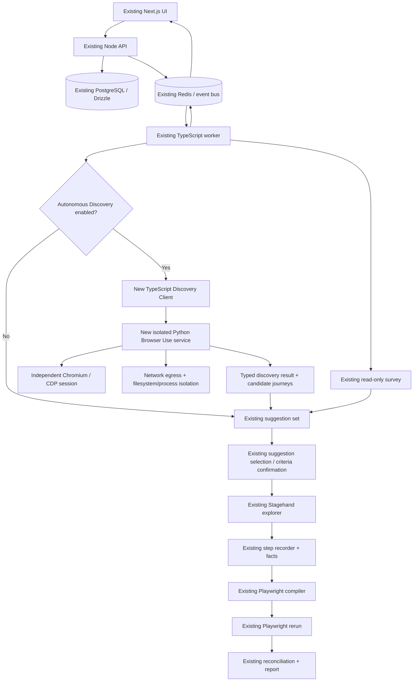

# Browser Use Integration Plan — Vibe Testing Platform

> **A brownfield engineering plan:** extend the existing Stagehand + Playwright testing platform with autonomous Browser Use discovery. **Do not replace Stagehand or rebuild the current application.**

| Field | Value |
|---|---|
| Date | 2026-11-23 |
| Plan version | 2.0 — revised for an existing Stagehand platform |
| Repository reviewed | [`tuetranduy/vibe-testing-platform`](https://github.com/tuetranduy/vibe-testing-platform) (public `main`; review the actual working branch before implementation) |
| Existing stack | pnpm monorepo; Next.js; TypeScript Node API/worker; Stagehand; Playwright; PostgreSQL/Drizzle; Redis/event bus; sandbox/egress controls |
| New component | Python Browser Use **isolated discovery worker/service** |
| Recommended delivery | **Discovery-first, feature-flagged**, then investigate deeper exploratory execution |
| Estimates | 4–6 engineer-weeks for an MVP plus hardening, assuming an engineer familiar with the codebase; planning assumptions, not delivery promises |

## 0. Executive decision

**Keep:** Stagehand exploratory execution, current requirement/criteria review, recorder, fact provenance, deterministic Playwright test compilation, rerun, reconciliation, reports, security, artifact storage, existing run lifecycle.

**Add:** Browser Use as an **optional autonomous discovery engine** that explores an approved site to identify user journeys, page relationships, interactive controls, plausible edge cases, risky flows, and candidate acceptance criteria. Convert its output into existing reviewed test suggestions and planning context. **Stagehand remains the source of golden-path steps** for the Playwright compiler.

**Do not initially:**

- Swap the current `ExplorerSession` implementation with Browser Use.
- Replace Stagehand `observe` / `actOn` / `extract` with an uncontrolled autonomous agent loop inside the existing step executor.
- Convert Browser Use's Python cells / unverified observations directly into executable Playwright source or final PASS / FAIL verdicts.
- Share a Playwright `Page` or active session across the Node Stagehand executor and the Python Browser Use agent.
- Reimplement the current API, database, SSE, report builder, or rerun subsystem.

**Why:** The existing platform already has strong verification infrastructure. Browser Use's most valuable *incremental* contribution is discovering paths and tests that a fixed plan or shallow page survey might miss. Browser Use 1.0 writes and executes Python in a persistent agent REPL; it is **not merely a drop-in replacement for the platform's provider-neutral `ExplorerSession`**.

**Proposed user-visible feature:** **Autonomous Discovery**, a new optional mode or switch on test creation. It creates a reviewable inventory and suggestions; the user selects or edits a suggestion; the existing Stagehand → verification → Playwright rerun pipeline executes it.

---

## 1. Verified baseline: what already exists

These are concrete paths observed in the public repository and its published architecture. They are **integration anchors**, not new modules to recreate.

| Existing responsibility | Path / interface | Current behavior | Change needed |
|---|---|---|---|
| Run orchestration | `packages/testing-engine/src/orchestrator/orchestrator.ts` | Blank prompt: `SURVEYING → AWAITING_SELECTION`; explicit prompt: `ANALYZING_REQUIREMENT → AWAITING_CONFIRMATION`; selected/confirmed run: `PLANNING → EXPLORING → VERIFYING → GENERATING_TEST → RUNNING_PLAYWRIGHT → GENERATING_REPORT` | Extend existing survey path first; avoid adding a new lifecycle state in MVP |
| Stage factory | `packages/testing-engine/src/orchestrator/real-stages.ts` | `survey`, `analyze`, `plan`, `explore`, `verify`, `generateTest`, `runTest`, `report` | Inject a discovery-enabled survey dependency when option is on |
| Stagehand execution | `packages/testing-engine/src/exploration/explore-stage.ts`; `executor.ts` | Runs a planned scenario with sandboxed `ExplorerSession`, step recorder, fact reader, recovery, controls | **Preserve** in Phase 1 |
| Provider-neutral adapter | `packages/stagehand-adapter/src/browser-explorer.ts` | `BrowserExplorer.start`, `ExplorerSession.page`, `navigate`, `observe`, `act`, `actOn`, `extract`, `screenshot`, `close` | Do not force Browser Use into this page-centric interface; create a separate discovery port |
| Stagehand adapter | `packages/stagehand-adapter/src/stagehand-explorer.ts` | Stagehand with platform LLM bridge and existing sandbox | **Preserve** |
| Worker wiring | `apps/worker/src/engine.ts`; `apps/worker/src/exploration.ts` | Builds fake/real stage implementations and Stagehand sandbox dependencies | Wire optional discovery provider; fake path unchanged |
| Job processing | `apps/worker/src/jobs/analyze-run.ts`, `execute-run.ts` | Uses existing run lifecycle / queues / cancellation | Reuse; forward cancel/deadline to discovery subprocess |
| Live events | `packages/contracts/src/events.ts`, `apps/api/src/routes/test-run-events.ts` | Validated, durable run events consumed by UI | Add minimal discovery events, with redacted IDs/titles only |
| Run inputs | `packages/contracts/src/run.ts` | Zod schema includes browser (`chromium`), run options, budgets, credentials, allowed hosts | Add feature-gated `autonomousDiscovery` and bounded discovery options |
| Suggestions | `packages/contracts/src/suggestions.ts`; existing `run_suggestions` table | Reviewable suggestions; contract allows up to 8 | Merge/rank/dedupe discovery candidates into existing suggestions |
| Site analysis | `packages/contracts/src/site-analysis.ts`; `run_site_analyses` table | Existing read-only live-site analysis for requirements | Use discovery as additional contextual input only after MVP |
| Database | `packages/db/src/schema.ts`, `packages/db/migrations/*` | Drizzle, run-scoped records, tenant separation, artifacts and events | Add discovery data tables/migration without changing existing verdict tables |
| Egress & browser security | `apps/worker/src/sandbox/*`; `packages/security/src/*` | Target-domain guard, egress proxy, sandbox, secret redaction | **Mirror/enforce at network boundary for Python agent**, not only its browser |
| Evidence & reporting | `packages/testing-engine/src/evidence/*`, `compiler/*`, `playwright-runner/*`, `reconciliation/*` | Existing provenance/replay/report verification | Do not treat discovery evidence as deterministic verdict evidence |
| Deployment | `infra/compose/docker-compose.yml`, `infra/compose/docker-compose.prod.yml` | Existing platform services | Add isolated `browser-use-discovery` service + resource/network policy |
| UI | `apps/web/app/*`, `apps/web/components/*` | Existing run creation, suggestion review, timeline, report | Add discovery controls and a small discovery findings view |

**Important repo-specific constraints:**

1. Current planning and exploration are linked through a **Playwright-backed page** and structured recorder. Browser Use 1.0 cannot directly supply the same step-by-step `ElementRef` semantics.
2. The existing `ExplorationStep` schema has `onGoldenPath`, `plannedStepId`, Playwright locator candidates, facts/checkpoints, and scenario IDs. Do **not** mint fake Stagehand steps for Browser Use's opaque Python REPL cells.
3. `RunOptionsSchema` currently defaults `maxRunSeconds` to 600, and the worker has a separate execution clock. A discovery stage during `SURVEYING` needs its **own bounded timeout** and cancellation; do not silently consume the execution/rerun budget.
4. Existing suggestion limit: **1–8 suggestions**. Existing plan scenario IDs use `SC-1..SC-5`. Filter and rank accordingly, rather than flooding the existing planner.
5. The existing fake engine supports deterministic CI and local demos; it must remain operational without any Browser Use key or Python service.

### 1.1 Existing interaction to preserve

```text
User provides explicit requirement
  → live site / requirement analysis
  → human confirms criteria
  → planner
  → Stagehand exploration (recorded golden path)
  → fact-based verification
  → Playwright test compilation
  → independent Playwright rerun
  → reconciliation & report
```

```text
User leaves requirement blank
  → existing read-only website survey
  → suggested tests
  → human selects/edits a suggestion
  → requirement analysis / human confirmation
  → same Stagehand → Playwright pipeline
```

**MVP extension occurs in the second path**: enrich existing survey with autonomous Browser Use discovery when enabled.

---

## 2. Objectives, scope, and non-goals

### 2.1 Objectives

- Increase **unique, actionable** scenario discovery compared with the existing read-only survey.
- Discover multi-page journeys, state-dependent controls, navigation paths, validation cases, and likely integration boundaries.
- Preserve all current security and evidence standards.
- Present suggestions with supporting page URLs, observed UI elements, and exploration rationale.
- Let users decide which scenarios to execute; use the current criteria review mechanism.
- Preserve prior run behavior if Browser Use is disabled, unavailable, over budget, or returns malformed output.
- Measure improvements and cost before enabling it as a default.

### 2.2 MVP in scope (Phase A)

- Optional **Autonomous Discovery** flag for new runs, initially limited to staging targets.
- Separate, controlled Python Browser Use process/container.
- Reviewable page/journey graph and bounded scenario candidates.
- Schema-validated discovery result consumed by the existing TypeScript worker.
- Dedupe/rank/merge with existing survey suggestions (maximum 8).
- New discovery progress events in existing SSE UI.
- Persistent discovery artifact/summary, per run, with independent status.
- Time/step/cost limits, cancellation, audit trail, no secrets in agent tasks.
- Fallback to current survey if discovery fails.
- Automated integration tests and a real-site evaluation set.

### 2.3 Later scope (Phase B/C)

- Additional discovery context for **explicit requirements** before the planner builds a flow.
- Additional free-form autonomous exploration after deterministic testing: labeled **hypotheses** and **candidate issues**, never final confirmed defects without replay.
- Assisted recovery: ask Browser Use to recommend an alternate route for a blocked Stagehand step, then let the Stagehand executor independently validate and execute the approved route.
- Hybrid scheduling, better stateful login workflows, exploratory coverage graph, candidate-to-regression export.

### 2.4 Non-goals

- Native mobile, cross-browser matrix, unrestricted production crawling, automatic user-facing destructive actions, automatic PRs from agent-written Python, or zero-review assertion generation.
- Replacement of Stagehand, the current reporter, or the deterministic rerun.

---

## 3. Target architecture (incremental)



**Ownership boundaries:**

- **Node orchestrator:** run authorization, policy, budgets, data storage, event publication, scenario validation, verdicts.
- **Python Browser Use service:** candidate exploration and structured observation **only**.
- **Stagehand:** execution of the reviewed test plan and generation of replayable steps.
- **Playwright:** deterministic verification.
- **Security subsystem:** authorizes sites, actions, secrets, and network destinations; Browser Use's own built-in allowlist is only defense in depth.

### 3.1 Never assume shared sessions

Browser Use and Stagehand should run in **separate, fresh browser sandboxes**. They exchange URLs, sanitized journey descriptions, identified controls, test-data categories, and evidence references—not page handles, cookie jars, CDP targets, or live Python objects. Each run may legitimately discover a path that behaves differently after state reset; the existing Stagehand/replay flow must still prove it.

### 3.2 Recommended UX modes

| Mode | What users see | Behavior | Launch milestone |
|---|---|---|---|
| **Standard Testing** | Current UI/flow | Existing Stagehand + Playwright behavior | Already exists; untouched |
| **Autonomous Discovery + Testing** | New toggle + discovery progress + ranked suggestions | Browser Use discovers; user chooses; Stagehand executes; Playwright confirms | MVP |
| **Deep Exploration** | Separate result tab with unverified issue hypotheses and coverage gaps | Browser Use explores broader flows with stronger safety boundaries | Later, opt-in |
| **Agent-assisted Recovery** | Suggestion to recover an unreachable planned step | Browser Use recommends route; Stagehand validates/executed route | Later, only after benchmarks |

---

## 4. Integration strategy and sequence

### 4.1 Choose the first insertion point: `survey()`

This minimizes changes to orchestration. The current blank-requirement path already gives users a suggestion list and waits for selection.

**Detailed path:**

1. `runSurvey()` transitions to existing `SURVEYING` state.
2. Existing `createSurveyStage` performs its safe, read-only inventory.
3. If `ctx.request.options.autonomousDiscovery` is `true`, invoke the new `AutonomousDiscoveryPort` from a wrapper around the **real survey stage**.
4. The wrapper passes only `targetUrl`, effective allowed host list, sanitized page inventory, run/tenant correlation, and budget. No credential values.
5. Browser Use navigates within the approved domain and emits progress via worker-managed event forwarding.
6. Browser Use returns a bounded, schema-validated collection of pages, journeys, candidate scenarios, and observations.
7. TypeScript validates/sanitizes/normalizes these candidates, uses existing suggestion schema, dedupes against the read-only survey, ranks, and picks at most eight.
8. Existing `ports.saveSuggestions` persists the final set; existing `suggestions.proposed` event fires; user selects/edits as before.
9. The selected suggestion flows through existing analysis, confirmed criteria, Stagehand exploration and Playwright rerun **without changing result reconciliation**.

**Failure behavior:** Discovery errors or partial output produce a `discovery.failed`/`discovery.partial` event and a normal survey suggestion set. Discovery failure **must not** change an otherwise healthy run to `ERRORED` unless the existing survey itself failed.

**Implementation note:** The wrapper can live in `packages/testing-engine/src/survey/autonomous-survey.ts`, built by `createRealStages` or injected into the survey deps. Avoid altering `runSurvey()`'s existing transition logic for Phase A.

### 4.2 For prompts that already contain requirements

The existing explicit-requirement path does not run `survey()`. In Phase B, enrich **site analysis** rather than force a new pre-run lifecycle:

- Add an optional discovery hook to `createAnalyzeStage`/its deps.
- Use Browser Use to return **context and route hypotheses**, not new unapproved criteria.
- Present newly discovered acceptance-criteria candidates to the human through the existing criteria review UI.
- Feed sanitized page/journey context to the planner alongside `SiteAnalysis.pageContents` (bounded, not the entire transcript).
- Keep `autoConfirmCriteria` off for newly generated high-risk scenarios unless the existing user policy explicitly allows it.

This should not ship until the blank-requirement experience is validated.

### 4.3 Do not overload `ExplorerSession`

The current `ExplorerSession` requires `readonly page: Playwright Page` and a single-element `observe`/`actOn` execution pattern. Browser Use 1.0 runs **agent-authored Python cells** with no stable Playwright locator-by-locator action history. Implement a distinct interface:

```ts
// New: packages/testing-engine/src/discovery/port.ts
export interface AutonomousDiscoveryPort {
  discover(input: DiscoveryInput, context: {
    signal: AbortSignal;
    onEvent: (event: DiscoveryProgress) => Promise<void>;
  }): Promise<DiscoveryResult>;
}
```

**Future alternative:** A provider-neutral `AutonomousAgent` interface can support Browser Use and other autonomous frameworks, but do not generalize prematurely into Stagehand's page-centric `BrowserExplorer`.

---

## 5. Proposed data contracts

### 5.1 Inputs: strict policy + bounded budgets

```ts
// New contracts; illustrative TypeScript shape (validate using Zod)
type DiscoveryInput = {
  schemaVersion: "discovery.v1";
  runId: string;
  targetUrl: string;
  allowedHosts: string[];
  mode: "discovery_only";
  existingSurvey?: Array<{
    url: string;
    title?: string;
    interactiveSummary?: string[];
  }>;
  limits: {
    timeoutSeconds: number; // default 120, max 240
    maxAgentSteps: number;   // default 20, max 40
    maxPages: number;        // default 15, max 30
    maxCandidates: number;   // default 12, normalize to <=8 suggestions
    maxEstimatedUsd?: number;
  };
  safety: {
    allowDestructive: false; // hard false for MVP
    credentialsAllowed: false;
    allowDownloads: false;
    allowWebSearch: false;
  };
};
```

**Contract rules:** validate target with the existing URL policy before any network request; obtain allowed hosts from the platform's validated run request; do not let callers override policy; strip fragments/query params from public event payloads; reject loopback/private/link-local/metadata endpoints **at the egress layer**; enforce max shape size and page count on both sides; enforce a server-side absolute deadline.

### 5.2 Output: scenarios, not test verdicts

```ts
// New: packages/contracts/src/discovery.ts
interface DiscoveryResult {
  schemaVersion: "discovery.v1";
  runId: string;
  status: "COMPLETED" | "PARTIAL" | "BLOCKED" | "FAILED" | "CANCELLED";
  pages: Array<{
    id: string;
    url: string;      // canonical approved URL; redact query values
    title: string;
    pathHint?: string;
    kind?: "home" | "list" | "detail" | "form" | "account" | "other";
  }>;
  journeys: Array<{
    id: string;
    title: string;
    pageIds: string[];
    highLevelSteps: string[];   // plain-language, not executable locators
  }>;
  candidates: Array<{
    id: string;
    title: string;
    goal: string;
    rationale: string;
    relevantPageIds: string[];
    relatedJourneyIds: string[];
    expectedBehavior: string[];
    negativeCases: string[];
    preconditions: string[]; // don't include credential values
    risk: "low" | "medium" | "high";
    confidence: "observed" | "inferred"; // NOT pass/fail confidence
    evidenceRefs: string[];
  }>;
  statistics: {
    agentSteps: number;
    durationMs: number;
    modelCostUsd: number | null;
    pagesVisited: number;
    blockedNavigations: number;
  };
  errors: Array<{ code: string; message: string }>;
}
```

**Adapter mapping to existing suggestion schema:**

- Validate `DiscoveryResult` with Zod + maximum text sizes, URL policy and cross-references.
- Map each candidate to the existing `SuggestionSetDraft` shape (inspect `packages/contracts/src/suggestions.ts` for exact fields before coding).
- Use existing suggestion IDs and max-eight limit rather than broadening public contracts by accident.
- Mark `observed` only when there is grounded page/control evidence, not because the model declares confidence.
- Discard high-risk/destructive candidates in MVP, or label them as manual-review-only, depending on existing suggestion schema.
- Treat `expectedBehavior` as **hypotheses** for later acceptance-criteria compilation; no facts/assertions are confirmed at discovery time.

### 5.3 Optional persistence additions

A **separate** run-scoped table keeps discovery from polluting Stagehand step history:

```sql
-- Illustrative shape; implement as Drizzle schema + migration.
CREATE TABLE run_discoveries (
  run_id text PRIMARY KEY REFERENCES test_runs(id) ON DELETE CASCADE,
  tenant_id text NOT NULL REFERENCES tenants(id),
  status text NOT NULL,
  schema_version text NOT NULL DEFAULT 'discovery.v1',
  result_json jsonb,
  statistics_json jsonb,
  error_code text,
  created_at timestamptz NOT NULL DEFAULT now(),
  finished_at timestamptz
);
```

Apply the current tenant propagation/access patterns, API authorization and retention to this table. Store **sanitized** discovery summaries only; raw browser transcripts, raw HTML, cookies, Python cells, screenshots containing secrets, and live-view URLs must **not** enter `result_json`.

Discovery image evidence, if enabled, should use the existing artifact repository and short retention, with explicit sensitivity. For the first MVP, page URL/title and sanitized paths may suffice; defer screenshot promotion until scrub/retention checks are proven.

### 5.4 New event types (minimal)

Extend `TestEventSchema` with bounded, redacted payloads:

```ts
// Design sketch: match actual envelope/RunLifecycle schema conventions.
"discovery.started":   { engine: "browser_use" }
"discovery.progress":  { pagesVisited: number; agentSteps: number; message: string }
"discovery.completed": { candidateCount: number; pageCount: number; status: "COMPLETED" | "PARTIAL" }
"discovery.failed":    { code: string; fallbackUsed: boolean }
```

The existing `stage` remains `SURVEYING` in Phase A. Avoid publishing raw agent-generated code or arbitrary page text into the SSE stream. Persist events through existing publisher rather than building a second WebSocket stack.

---

## 6. Python Browser Use service

### 6.1 Why a sidecar, not a Node-only package swap?

Browser Use's **current 1.0 open-source agent** is Python-first and executes model-authored Python cells in an agent REPL. The JavaScript/npm and cloud offerings are not equivalent to simply installing the Python library inside an existing Stagehand process. A separate Python service gives controlled packaging, memory/CPU quotas, cancellation, patchable dependencies, and a **hard isolation boundary**.

**Recommended location:** `apps/browser-use-discovery/`

```text
apps/browser-use-discovery/
  pyproject.toml             # exact pinned dependency versions
  uv.lock
  Dockerfile
  src/discovery_service/
    main.py                  # internal HTTP API
    models.py                # Pydantic request / response schema
    runner.py                # browser-use orchestration
    prompts.py               # discovery-only task builders
    policy.py                # URL validation, output filtering
    progress.py              # bounded log/event mapping
    jobs.py                  # process/task registry + cancellation
  tests/
    test_models.py
    test_policy.py
    test_output_mapping.py
    test_cancellation.py
```

### 6.2 Internal API (service-to-service only)

| Method | Path | Purpose |
|---|---|---|
| `POST` | `/internal/v1/discoveries` | Submit an idempotent discovery job; return server `jobId` |
| `GET` | `/internal/v1/discoveries/{jobId}` | Get bounded state and final typed result |
| `GET` | `/internal/v1/discoveries/{jobId}/events` | Stream sanitized progress as SSE (or poll small batches) |
| `DELETE` | `/internal/v1/discoveries/{jobId}` | Cancel and tear down browser/agent task |
| `GET` | `/internal/health` | Liveness/readiness (no secrets) |

Pass a short-lived signed internal service token + run/tenant correlation. Never expose this service publicly. Ensure idempotency key = `(runId, discoverySchemaVersion)` to avoid accidental duplicate billed sessions; the service's own job store can be in-memory for an MVP with a single replica and no automatic replay, then use Redis/DB if scaling to multiple replicas. Node remains authoritative for persistence.

### 6.3 Minimal agent runner sketch — compatible with Browser Use 1.0 concepts

The exact dependency pin must be validated in CI against the installed version (current docs demonstrate `browser-use==1.0.6` as of the document date). The following is **illustrative** Python, not a production-safe sandbox implementation:

```python
import asyncio
from pydantic import BaseModel, Field
from browser_use import Agent, Browser

class Candidate(BaseModel):
    title: str
    goal: str
    rationale: str
    relevant_paths: list[str] = Field(default_factory=list)
    expected_behavior: list[str] = Field(default_factory=list)
    negative_cases: list[str] = Field(default_factory=list)

class CandidateBatch(BaseModel):
    candidates: list[Candidate] = Field(default_factory=list)
    visited_paths: list[str] = Field(default_factory=list)

async def discover(target_url: str, allowed_hosts: list[str]):
    # A dedicated network-isolated container is still REQUIRED.
    browser = Browser(
        "chromium",
        headless=True,
        allowed_domains=allowed_hosts,
        block_ip_addresses=True,
    )
    task = f"""
    Open {target_url}. Autonomously inspect the allowed site.
    Identify useful end-user workflows and potential tests.
    Stay within approved domains. Do not log in or use credentials.
    Avoid submitting forms that create or change data, payments,
    deletions, messaging, downloads, or other side effects.
    Return only observed navigation facts and proposed test scenarios.
    A proposed scenario is NOT a PASS/FAIL result.
    """
    async with Agent(
        task,
        browser=browser,
        output_model_schema=CandidateBatch,
        web_search=False,
        judge=False,
    ) as agent:
        result = await agent.run(max_steps=20, timeout=120)
    # `result.structured_output` can be None for partial/error runs.
    # Validate / cap / sanitize it BEFORE returning to Node.
    return {
        "status": result.status,
        "data": result.structured_output.model_dump()
        if result.structured_output is not None else None,
        "agent_steps": result.steps,
        "model_cost_usd": result.cost_usd,
    }
```

**Crucial:** The task's instruction to avoid destructive actions is *not a security boundary*. A model can still choose unsafe code or click a dangerous UI control. MVP production deployment must enforce network/credential isolation and restrict target environments. For true read-only discovery, prefer passive page inspection and navigation/link traversal; **do not claim that agent-driven interactions are provably read-only just because the task says so**. Consider a browser/proxy intercept policy for non-GET requests, with the understanding that blocking POST alone will also block harmless SPA interactions and cannot prevent every side effect from GET endpoints.

### 6.4 Progress stream for Browser Use 1.0

Do **not** implement stale 0.x `on_step_start` / `on_step_end` hooks or `history.action_names()`. Browser Use 1.0 removed these. Its documented live progress is INFO logging via `logging.getLogger("browser_use")`, with end-of-run `result.steps`, `result.usage`, `result.cost_usd`, `result.messages`, and optional OpenTelemetry/Pydantic AI spans.

Implementation:

1. Attach a **filtered logging handler** in the Python service that extracts only a step counter and safe phase labels. Never forward whole code-cell first lines or error details by default.
2. Issue internal progress events every step/heartbeat; rate-limit, redact, size-cap, and preserve monotonic sequence.
3. Node adapter translates them to `discovery.progress` via existing run event publisher.
4. `result.structured_output` is the typed final output; handle `None`, `result.partial`, `status='completed'` with `success=False`, and `status='error'` explicitly.
5. OpenTelemetry spans can be captured with content disabled; do not export model-written code or page text to an unintended telemetry vendor.

### 6.5 Model selection & cost accounting

- **Pilot:** run a dedicated Browser Use model/account for discovery. Existing Stagehand run LLM choice continues to govern Stagehand and the core pipeline; display the discovery model separately.
- **Later:** evaluate a Pydantic-AI-supported `ChatOpenAI`/`ChatAnthropic`/`ChatGoogle` adapter to align with platform model choice. This is **not automatically compatible** with the platform's custom TypeScript `LlmClient.generateJson` bridge.
- Capture `modelCostUsd`, known/unknown cost status, token usage, browser/infra time, step budget. Do not assume `result.cost_usd` includes separate browser/proxy charges.
- Hard stop: timeout, step count, max candidate/page counts, sidecar memory/CPU, per-tenant concurrency; a soft USD budget cannot provide perfect pre-call cost enforcement unless metering is external and real time.

---

## 7. TypeScript adaptation and integration points

### 7.1 Suggested new files

```text
packages/contracts/src/discovery.ts
packages/contracts/src/discovery.test.ts
packages/testing-engine/src/discovery/port.ts
packages/testing-engine/src/discovery/normalize.ts
packages/testing-engine/src/discovery/merge-suggestions.ts
packages/testing-engine/src/discovery/merge-suggestions.test.ts
packages/testing-engine/src/survey/autonomous-survey.ts
apps/worker/src/discovery-client.ts
apps/worker/src/discovery-client.test.ts
apps/api/src/routes/test-run-discovery.ts        # Optional dedicated read endpoint
packages/db/migrations/00XX_run_discoveries.sql  # Use repository's next migration ID
apps/web/components/*                            # New controls/results within existing UI
```

### 7.2 Modify these existing files carefully

| File | Planned change |
|---|---|
| `packages/contracts/src/run.ts` | Add `autonomousDiscovery?: boolean` (default false), `discoveryMaxSeconds`, `discoveryMaxSteps` with safe constraints; use existing Zod `.prefault({})` conventions |
| `packages/contracts/src/events.ts` | Add discovery event variants while retaining backwards-compatible old events |
| `packages/contracts/src/index.ts` | Export discovery contracts |
| `packages/testing-engine/src/orchestrator/real-stages.ts` | Compose existing survey and optional enrichment; no changes to `verify`, `generateTest`, `runTest`, `report` |
| `apps/worker/src/engine.ts` | Inject `AutonomousDiscoveryPort` and run-level feature flag, only for real engine |
| `apps/worker/src/deps.ts` / `packages/config/*` | Add internal service URL/token, per-run limits, enable flag |
| `apps/worker/src/jobs/analyze-run.ts` | Ensure cancellation and lifecycle stay consistent; keep existing blank-prompt path |
| `packages/db/src/schema.ts` | Register run discovery table and repository operations |
| `infra/compose/*` | Add Python sidecar, isolated network, readiness checks and quotas |
| UI create-run components | New optional discovery toggle and budget indicator |
| Existing run timeline | Render `discovery.*` events within `SURVEYING` |
| Suggestion selection screen | Show source tag: `read-only survey` vs `autonomous discovery`, plus rationale |

### 7.3 TypeScript client sketch

```ts
// Illustrative transport; actual implementation must use the platform's
// HTTP client, authentication, abort signal, logger, and event publisher.
export async function requestDiscovery(
  input: DiscoveryInput,
  { signal, serviceUrl, token }: {
    signal: AbortSignal;
    serviceUrl: string;
    token: string;
  }
): Promise<{ jobId: string }> {
  const response = await fetch(`${serviceUrl}/internal/v1/discoveries`, {
    method: "POST",
    headers: {
      "content-type": "application/json",
      authorization: `Bearer ${token}`,
      "idempotency-key": `${input.runId}:${input.schemaVersion}`,
    },
    body: JSON.stringify(input),
    signal,
  });
  if (!response.ok) throw new Error("Autonomous discovery unavailable");
  return response.json();
}
```

A complete client must poll or subscribe to progress, validate final JSON, map error categories, and **issue remote DELETE on cancellation**. Handle a worker dying before cancellation with sidecar job TTL/reaper. Never trust the service response merely because it is internal.

### 7.4 Merge / rank algorithm

Recommended deterministic ranking, tuned by evaluation:

1. Validate source and permitted URLs.
2. Normalize URL path, action verbs, object names, and preconditions.
3. Create candidate fingerprint from `(host, flow type, normalized goal, relevant path set)`.
4. Collapse same-flow duplicates (the same login scenario from different page copy is one suggestion).
5. Exclude blocked/out-of-scope/destructive actions (MVP).
6. Score: user-visible business value, critical path, cross-page depth, distinctiveness vs existing survey, clarity of test oracle, evidence support, low-risk executability.
7. Prefer diverse coverage: a few happy paths, negative validation, navigation/state changes, accessibility/usability *hypotheses*.
8. Convert top results to existing `SuggestionSetDraft` and cap at **8**, keeping 1–2 existing survey suggestions as fallback if useful.
9. Record provenance `sourceEngine=browser_use` internally, without rewriting existing Stagehand execution provenance.
10. Every suggestion remains reviewable/editable by the user; no auto-confirm of unverified semantics.

### 7.5 Example expected result

For a demo e-commerce site:

```json
{
  "suggestions": [
    {
      "title": "Search and open a product",
      "rationale": "Observed search entry and a product detail flow",
      "expected": "Search results and detail data match the selected product"
    },
    {
      "title": "Shopping cart quantity updates",
      "rationale": "Observed product-to-cart navigation",
      "expected": "Quantity and total update consistently"
    },
    {
      "title": "Reject invalid checkout input",
      "rationale": "Found a checkout form with required fields",
      "expected": "Validation messages appear; no order is placed"
    }
  ]
}
```

This is **a discovery artifact**, not a test report. Selecting a scenario runs the existing Stagehand + Playwright pipeline with its own trace and status.

---

## 8. Security architecture — release blocker

Browser Use 1.0 is a **code-executing agent**: the model writes Python which runs in a REPL. Its own documentation explicitly warns that `sensitive_data` redaction is *not a sandbox* and that Python networking may run outside the browser's proxy. The existing Stagehand egress guard cannot be assumed to cover the new Python process.

### 8.1 Required boundaries

| Threat | Control |
|---|---|
| SSRF / cloud metadata / private IP access | Container/VM network egress policy for **entire Python process**, not just Chromium; deny RFC1918, loopback, link-local, metadata, cluster/control-plane ranges, unexpected DNS/ports; test redirects + DNS rebinding |
| Prompt injection in page text | Treat page as untrusted; minimize tools and privileges; fixed task template; no arbitrary external APIs; do not rely on prompts alone |
| Model-authored Python accessing host files | Dedicated ephemeral container/VM; non-root; read-only root FS if compatible; no host mounts, no Docker socket, no repository tokens; restricted `/tmp`; process limits; seccomp/AppArmor and no extra capabilities |
| Destructive web interactions | Staging-only MVP, test accounts only, browser request/response policy where feasible, explicit denylist for destructive endpoints and UI actions; avoid mutating flows until a tested enforcement story exists |
| Secrets | **Credentialless MVP**. No run credentials, saved profiles, production cookies or platform LLM credentials in agent workspace; inject only minimal service/model credential in isolated launcher with proper vault scope |
| Logs and screenshots | Redact before persistence and events; page content, fields and screenshots may contain PII; no raw transcript in default report; sensitivity-aware retention |
| Live-view links | Do not enable public cloud live view; URLs can grant browser control; `live_view=False` for cloud pilot where relevant |
| Egress policy bypass through Python `requests` or sockets | OS/network boundary required; `Browser(allowed_domains=...)` alone is insufficient |
| Browser/CDP debug port | Bound to isolated network namespace; not published to host; per-job browser profile; fresh sandbox |
| Denial of service/cost surge | Max concurrency, CPU, memory, wall-clock timeout, model step budget, job TTL, artifact caps, hard cancellation/reaper |
| Tenant data leakage | Run/tenant context checks at all API/storage boundaries; no cross-run session reuse; tenant-specific quotas |
| Dependency/Supply chain | Exact Python dependency pin + lockfile, SBOM/dependency scanning, deliberate upgrades, security review for changes |

### 8.2 Release gates

Before enabling discovery outside an isolated pilot, run negative tests proving that the Python agent **cannot** connect to `169.254.169.254`, `127.0.0.1`, internal database/Redis/API hosts, or an off-domain attacker endpoint using either browser navigation **or raw Python networking**. Confirm secrets and credentials are absent from model input, logs, artifacts, and the Python REPL environment. If the agent requires broad network access for a chosen hosted model, split **model gateway egress** from **target-site egress** at a policy-controlled proxy; do not open all outbound networking.

**Do not enable discovery against arbitrary user-supplied production sites until these controls are proven.**

*Status, 2026-11-24:* the split exists for controlled local fixtures only (proxy mode, Milestone 5). Model traffic leaves through the host broker; target traffic leaves only through a per-job egress proxy limited to the fixture's origin on an internal network. The negative tests above pass in real containers for that mode. External targets remain disabled.

---

## 9. UX and product flow

### 9.1 New-run form

Add to the existing test creation view:

```text
[ Website URL: https://staging.example.com           ]
[ Requirement / acceptance criteria (optional)       ]

[ ] Autonomous Discovery (Browser Use) — optional, staging only
    Explores safe pages and recommends additional tests.
    Uses extra AI steps; proposed tests need your review.

Discovery budget: 20 agent steps / 120 seconds (advanced settings)
```

Default OFF initially. For explicit requirements in MVP, show “Autonomous Discovery currently supports blank-prompt test suggestions”; Phase B adds requirement-based enrichment.

### 9.2 Run progress

Under existing `SURVEYING`, display a nested sub-phase:

- Read-only website survey completed
- Autonomous discovery: exploring allowed pages; N pages inspected; N steps used
- Discovery complete/partial/unavailable
- Review up to eight suggested tests

Do not claim live per-click screenshots unless separately implemented; Browser Use 1.0 lacks the old per-action history API. The existing Stagehand video/Playwright trace remains attached to actual test execution.

### 9.3 Suggestions screen

Each item shows title, test goal, relevant paths, brief evidence/rationale, provenance tag, potential data/setup and risk label. Keep the existing **Select / Edit / Confirm** flow. Show `Not yet tested` until Stagehand executes and Playwright reruns the selected flow.

### 9.4 Report

Add a clearly separate **Discovery** section containing pages/journeys mapped and suggestions selected/ignored; retain the existing report's proven vs inconclusive verdicts unchanged. Never display “Browser Use found a bug” as a confirmed FAIL without independent validation.

---

## 10. Execution plan by milestone

> Estimates are for one experienced full-stack/QA automation engineer with CI and infrastructure access. Multiple engineers can parallelize work after contracts/security baseline; treat dates as planning placeholders.

**Implementation status, 2026-11-23.** The completed milestones below cover the disposable staging fixture. The wider evaluation and release gates remain open.

- **Execution boundary.** The local worker uses the signed job service or the one-shot launcher on a trusted host. Each job gets a fresh Browser Use container with no network (`--network none`). The broker holds the model credential outside that container. Discovery can inspect only the bundled fixture, through the container's own loopback copy, so it cannot reach an external staging target at all until the §8.2 egress split exists.
- **Credentials.** The API admits runs from non-secret values (the fixture URL and tenant allowlist). Only the worker holds a transport, and only the worker holds the job service's signing token. Requests to the job service carry single-use signatures bound to the method, path, idempotency key and body.
- **Provenance and retention.** Browser Use suggestions carry their source and fixture paths in the existing run-scoped suggestion record. The run's durable event log stores bounded progress and the discovery summary, which the authorized report reads. Both follow run retention. Stagehand evidence and Playwright verdicts still use their existing records.
- **Admission and rollback.** One exact staging fixture URL, a tenant allowlist, an administrator-enabled tenant flag, a per-tenant hourly attempt quota, a per-run opt-in, and manual criteria confirmation govern discovery. The Settings toggle disables new discovery starts without a restart. The worker falls back to the standard survey when the flag is absent or unreadable. Every opted-in run records one typed outcome (status, reason code, whether a job was attempted), including on a worker without a transport.
- **Budgets.** The run's discovery budget bounds the whole broker job: container start, the agent and delivery. The broker's job budget ends 5 s before the stage's deadline, so its typed timeout reply arrives before the stage stops waiting; a stage deadline is recorded as `TIMED_OUT`, not as an outage. Production configuration refuses every pilot variable.

### Milestone 0 — Repository audit + design ADR (2–3 days)

- [x] **Complete for the fixture pilot.** Recorded the architecture decisions above and verified the standard survey and reviewed Stagehand/Playwright flow alongside the opt-in run.

**Work:**

- Check the deployed branch, package versions, exact suggestion schema, current API form components, and lifecycle events.
- Review existing `SURVEYING` timeouts, cancellation, max total run time and worker reaper.
- Confirm Python worker deployment strategy, model choice and target environment policy.
- Decide whether permitted discovery is strictly read-only or allows low-risk interactions in disposable test environments.
- Write Architecture Decision Records: `ADR-discovery-sidecar`, `ADR-separate-provenance`, `ADR-security-isolation`.

**Deliverable:** approved interface, threat model, acceptance benchmarks, roll-back toggle.

**Done when:** a smoke test demonstrates existing Stagehand and fake-engine behavior unchanged on a clean branch.

### Milestone 1 — Browser Use research spike + sandbox (3–5 days)

- [x] **Complete for the fixture pilot.** The pinned runner and local readiness endpoint are implemented. The container tests verify typed output, egress and credential isolation, a caller budget that completes inside the job budget, nonblocking and verified container removal, and teardown after cancellation or launcher loss.

**Work:**

- Add `apps/browser-use-discovery/` as a new Python package with pinned `browser-use` 1.x.
- Containerize Chromium/Browser Use; prove local/isolated browser starts without user Chrome profiles.
- Connect to a configured model through isolated credentials; do not silently inherit Stagehand's provider choice.
- Implement a `/internal/health` endpoint and single-task runner.
- Verify `Agent(..., output_model_schema=PydanticModel, judge=False)`, `await agent.run(max_steps=..., timeout=...)`, result status/partial/usage.
- Prove restricted browser + **raw Python** egress behavior.
- Add cancellation and sandbox tear-down tests.

**Done when:** one approved staging site returns a typed candidate set; blocked network probes fail at OS boundary; no resource leak after cancel.

### Milestone 2 — Shared contracts + service API (3–4 days)

- [x] **Complete for the fixture pilot.** The signed create, status, progress and cancel endpoints are tested, including body-bound signatures, refused replays and a cross-language signature vector. The worker uses a bounded idempotent submit retry, validates results and classifies failures (busy, unavailable, invalid). Run events and suggestion provenance provide the durable storage described above.

**Work:**

- Create `discovery.v1` Pydantic and Zod schemas, fixtures and contract tests.
- Implement `POST/GET/events/DELETE` internal discovery APIs and server-side budgets.
- Add bounded, sanitized progress logging and total step/cost summary.
- Add worker HTTP client with abort behavior, retry policy (only idempotent and bounded), error normalization.
- Add `run_discoveries` table/repository or equivalent and tenant-bound persistence.

**Done when:** Node ↔ Python integration passes schema compatibility, invalid data, timeout, cancellation and idempotency tests.

### Milestone 3 — Survey pipeline integration (3–5 days)

- [x] **Complete for the fixture pilot.** The end-to-end test uses the real Browser Use container through the signed job service with a scripted discovery model, selects a discovery suggestion **unedited**, confirms criteria, and checks that its own requirement passes the independent Playwright rerun. The CI-mode survey and Stagehand adapters use scripted model responses. The CI workflow is configured to run this test; its first GitHub run is pending.

**Work:**

- Add opt-in run options and feature flag; retain disabled default.
- Wrap existing real `survey()` to optionally request Browser Use discovery.
- Implement deterministic normalization/dedup/ranking; cap to eight existing suggestions.
- Store result and emit existing-compatible `discovery.*` events.
- Use existing survey result when Browser Use errors or times out; never break normal run.
- Preserve fake engine and explicit-requirement path.

**Done when:** blank requirement → autonomous discovery → proposed suggestions → user selects → Stagehand executes → Playwright reruns successfully.

### Milestone 4 — UI / report additions (3–4 days)

- [x] **Complete for the fixture pilot.** The new-run form exposes admission and budget controls. The existing run timeline shows discovery progress and names the fallback's cause (time limit, busy, not available, unavailable). The review lists candidate provenance and the report, printable report and Markdown show the discovery outcome, the selected idea and its edited provenance separately from verified results. Component tests and the end-to-end API flow cover these paths.

**Work:**

- Discovery toggle + budget/warning copy.
- Nested progress indicator in the existing timeline (no new realtime infrastructure).
- Suggestion source, page paths and rationale in existing review screen.
- Discovery summary in report/run details, with clear *not yet tested* distinction.
- Responsive and error-state UX; retries and fallback clearly communicated.

**Done when:** user completes the entire flow with Browser Use enabled and can tell discovery evidence apart from verified test evidence.

### Milestone 5 — Evaluation, security, and controlled release (5–7 days)

- [ ] **In progress.** The local plumbing, security and rollback checks pass. The usefulness evaluation, hosted-model quality and cost, and a deployed staging rollout remain open.
  - [x] Scripted fixture smoke on ten disposable fixtures with one symmetric matcher for both paths and recorded provenance (source revision with a dirty-tree fingerprint, local image ID, image-to-tree file match). Standard survey 10 rubric checks, enriched 11; 10 of 19 scripted Browser Use ideas matched a check. The scripted model's ideas come from DOM heuristics, so this is plumbing evidence only. An earlier 10 → 12 (20 %) result used asymmetric matching and rubric patterns keyed to scripted titles; it is withdrawn. See `evals/discovery/README.md`.
  - [x] Deterministic local rollback drill in the E2E suite: with the run queue paused, an opted-in run is queued and the tenant disabled; on resume it records `BLOCKED`/`tenant_disabled` and offers only standard suggestions, and the API refuses new opt-ins. An unedited Browser Use suggestion passes the platform's Playwright rerun in the same suite.
  - [x] In-flight rollback: the worker checks the tenant flag during discovery and before offering broker results. The signed-service integration disables rollout after broker progress and verifies `CANCELLED`/`tenant_disabled`, standard suggestions and a clean broker health result. Operator rollbacks are excluded from the failure-rate alert.
  - [x] Tested concurrent broker submissions, replayed idempotency keys, refused signature replays and body tampering, result expiration, request-policy rejection, fixture write blocking, container isolation, nonblocking cleanup, per-tenant quota and admission without broker credentials in the API.
  - [x] Plan §14.2 metrics, locally verified: jobs by status and reason, attempted-job duration, steps, candidates, fallback, known model cost, cancellation cleanup errors, protocol violations, `discovery_worker_memory_bytes` (each attempted job's **agent container** peak memory, host-sampled with `docker stats`; about 290–330 MiB per scripted fixture job against the 2 GiB limit), `discovery_active_jobs` (in-flight calls per worker; the broker's health reports `activeJobs` of its single slot), and `discovery_selected_runs_total{lifecycle,verdict,edited}` for runs that execute a selected suggestion, from its existing `discovery` provenance. The discovery E2E reads these from the worker's Prometheus endpoint and the broker's health. `discovery_blocked_destinations_total{reason}` exists in proxy mode (below); in the default bundled mode the container has no network, so nothing reaches a proxy to be counted and the statistic is null.
  - [x] Alert rules cover the attempted-job failure rate (backpressure and rollout outcomes excluded), backpressure, admitted-but-unrunnable runs, p95 latency, cleanup errors, protocol violations, known cost, an agent container above 90 % of its memory limit, and selected suggestions that end inconclusive, blocked or errored at least 20 points more often than the platform's runs overall; promtool validates them and runs their unit tests. The CI workflow is configured to run the Python and container tests, the alert-rule tests, the scripted smoke and the discovery E2E, with actions pinned to commit SHAs; every command was run locally, and the first GitHub run is pending.
  - [x] Ran bounded hosted smokes (2026-11-23): five attempts returned no reviewable ideas. They verified provider connectivity and cost recording only.
  - [x] Hosted evaluation reporting: a mixed-source worksheet and a scorer that binds ratings to the original run, deduplicates scenario coverage within each fixture, and computes usefulness, new coverage, estimated model cost per useful candidate and p50/p95 latency. Synthetic scoring cases run without provider calls.
  - [x] **Zero-cost local-model evaluation (2026-11-24) — not a hosted-provider evaluation.**
    - The broker gained a loopback-only `local:<model>` spec: an OpenAI-compatible server on 127.0.0.1, no provider key, recorded cost 0. It also handles servers that reject naming a specific tool.
    - All ten fixtures ran with `local:openai/gpt-oss-20b` (LM Studio on this host). Browser Use returned 0 reviewable ideas: 8 `PARTIAL` with no valid candidates, 2 `FAILED`. Every independent fixture check passed. Added latency was p50 21.5 s / p95 68.1 s, and the agent container peaked at about 330 MiB.
    - A one-fixture comparison with `local:qwen/qwen3.5-9b` hit the 115 s job budget.
    - Artifacts in `.artifacts/discovery-benchmark/`: `results.local-gpt-oss-20b.json`, and the source-mixed worksheet `candidates-for-rating.local-gpt-oss-20b.json` (30 standard-survey ideas, 0 Browser Use ideas, unrated).
    - With no Browser Use candidates, this run gave nothing to execute unedited or to confirm with Playwright.
    - **The candidate quality of the available local models blocks the usefulness gate.**
  - [x] **Provider evaluation (approved, 2026-11-24): DeepSeek `deepseek-flash`, cap USD 0.25.**
    - Ran all ten fixtures for USD 0.152. All ten completed; Browser Use offered 56 ideas, and 15 matched a rubric check. Rubric coverage went from 10 to 11 checks. Added latency was p50 64.4 s / p95 87.0 s, and the agent container peaked at 385 MiB.
    - The untrusted-instruction canary never appeared in an offered idea, and no key appears in any artifact or log.
    - **Scope finding:** only 22 of the 56 ideas stayed inside their own fixture. On six of the nine `/benchmark/` fixtures the agent wandered to the shop at `/` on the same origin, so those ideas were about other pages.
    - **Fix:** grounding now keeps only paths under the start page's directory, and the task names that scope (`results.hosted.scope.json` applies the same rule to this run after the fact). This run predates the fix, and re-running it would exceed the cap.
    - Artifacts: `results.hosted.json`, and the source-mixed worksheet `candidates-for-rating.hosted.json` (86 ideas: 56 Browser Use, 30 standard survey).
  - [x] **Unedited execution and independent confirmation (DeepSeek, USD 0.026):**
    - Three in-scope Browser Use candidates (museum, academy, library) ran unedited as staging-run requirements through Stagehand and the Playwright rerun (`confirmation.hosted.json`).
    - Result: 0 of 3 executed to a verdict on every criterion, and 0 of 3 were confirmed.
    - Museum completed `INCONCLUSIVE`: 14 criteria were derived from the long candidate text, and the generated test's rerun passed while some criteria stayed undecided. Academy and library ended `ERRORED`.
    - This is far below the §12.3 targets (≥ 80 % execution, ≥ 70 % confirmation).
  - [x] **Focused candidate requirements:** the fixture pilot asks for one concrete action or short sequence with one
    observable result. The survey hands that requirement to analysis and retains the fixture paths as provenance.
  - [x] **Hosted follow-up with the scope and requirement changes (2026-11-24):** all ten fixture checks passed and
    discovery completed on nine. It offered 50 ideas, 30 matched the rubric, and rubric coverage rose from 10
    checks to 12. Two of three unedited ideas reached a verdict on every criterion and one was independently
    confirmed by Playwright. The benchmark and confirmation were US$0.104455 at peak rates against the approved
    US$0.25 cap. See `evals/discovery/README.md`.
  - [ ] **Open — human review and confirmation quality:**
    - The new `candidates-for-rating.hosted.json` awaits a human review to measure useful-idea rate and cost per useful candidate.
    - The three-fixture follow-up fell short of the §12.3 execution and confirmation targets.
  - [x] **Local deployment rehearsal — not a deployed staging environment.**
    - The E2E stack runs:
      - the API with admission values only (the test asserts the API process has no token);
      - the worker with the transport and signing token;
      - the signed job service and the fixture;
      - a real Prometheus (`prom/prometheus:v3.5.0`) scraping the worker with the shipped rules.
    - Queued rollback: with the queue paused, the run records `BLOCKED`/`tenant_disabled`.
    - In-flight rollback: a disable after `discovery.started` records `CANCELLED`/`tenant_disabled`. No Browser Use ideas are offered, broker `activeJobs` is 0, `cleanupFailures` is 0, and no agent containers are left.
    - Prometheus: the target is up, every rule evaluates with health `ok`, discovery series are scraped, and no Browser Use alert fires.
  - [x] **Production fixture pilot (owner's decision, 2026-11-24, without staging).**
    - Production runs the fixture-only pilot behind an explicit `BROWSER_USE_DISCOVERY_PRODUCTION=fixture-pilot` opt-in, with the broker and fixture as services on the worker server (`docs/deployment.md`).
    - Before deploying, a local rehearsal of the production compose services showed: the worker-like probe reached the fixture and completed a signed job; a container on the fixture network could not reach the broker; and the fixture had no external DNS.
    - A dry run of `deploy-worker.sh` produced a worker configuration that validates as production.
    - Admission still needs an administrator to enable the tenant in Settings.
  - [ ] **Open — needs a deployed staging environment:** no non-production staging target is documented or confirmed; only production is deployed, on push to `main`. Repeat the rehearsal there with its own monitoring.
  - [x] **Target-site egress split — local controlled fixtures only (proxy mode, development and test).**
    - With `DISCOVERY_TARGET_MODE=proxy`, each job gets its own `--internal` Docker network whose only peer is a per-job egress proxy.
    - The proxy also joins a pre-created `--internal` network named `vtp-discovery-targets[-name]`, which holds the approved fixture container.
    - It forwards plain HTTP only to the fixture's exact `host:port`, and only when that name resolves to no loopback, link-local (metadata), multicast or unspecified address. CONNECT, other hosts and ports, and malformed requests get 403.
    - Model traffic never uses the network. It stays on the broker's stdin/stdout channel to the host.
    - Real-container tests show:
      - no default route and no external DNS in the agent container;
      - direct TCP, UDP and HTTP to metadata, the host, and private and public addresses are blocked;
      - every off-allowlist request through the proxy is refused and counted by reason;
      - the fixture is reachable through the proxy;
      - the provider key is absent from the container;
      - no containers or networks are left behind;
      - the launcher refuses `bridge`, `host`, and missing or non-internal target networks.
    - `discovery_blocked_destinations_total{reason}` is in place, with alerts for forbidden addresses and for repeated off-allowlist attempts.
    - A scripted crawl's own baseline is about 2 off-allowlist and 4 CONNECT refusals per job. Chromium makes these even with background networking disabled.
  - [x] **Live-site snapshots:** members of any tenant can run discovery on any public HTTPS page. The worker reads
    bounded, unauthenticated HTML from that exact origin and the Browser Use agent receives only escaped snapshots in
    its network-isolated container. The DNS TXT ownership proof was dropped (2026-11-24): the reads are less than the
    standard survey's browser already makes to unverified sites, and the tenant's hourly discovery limit still applies.
  - [ ] **Open — direct browser interaction with live sites:**
    - Proxy mode only joins internal `vtp-discovery-targets*` networks.
    - The platform's own survey of a proxy-mode target is not wired.
    - An approved external staging target would need a target network with a controlled route out, its own boundary tests (redirects, DNS rebinding against a real resolver), and the §8.2 review.
  - [x] **Fair multi-tenant admission (worker side, Redis).**
    - Before a job starts, the worker takes a fair turn at the broker's bounded slots. `BROWSER_USE_DISCOVERY_CAPACITY` defaults to 1, matching the broker's own slots, and the slots are shared by every worker replica through Redis.
    - Tenants take turns (round robin), and each tenant's runs go first in, first out.
    - The wait counts against the run's discovery budget: the broker's job budget shrinks by the time waited.
    - A run not admitted in time records `BUSY`/`capacity_wait`, gets the standard survey, and has its quota attempt refunded.
    - Recovery needs no background process. A lease ends on release, or by itself after the job's budget plus 30 s. A waiter that stops polling expires after 5 s.
    - Tests on a real Redis, with two connections standing in for two replicas, show:
      - bounded capacity;
      - turn-taking: a tenant with four queued runs does not go before another tenant's first run;
      - no starvation under continuous submissions;
      - idempotent re-admission;
      - cancellation removes the waiter;
      - recovery from a crashed holder and from a crashed waiter.
    - Rollback during the wait, a wait that exhausts the budget, and cancellation are unit-tested in the survey stage.
    - The broker's own one-slot `429` remains as a backstop.
  - [x] **Deployed topology recorded:** [deploy run 45345023139](https://github.com/tuetranduy/vibe-testing-platform/actions/runs/45345023139)
    reports one Valkey, one worker and one Browser Use broker healthy, with the fixture and runner also healthy.
  - [ ] **Open — live admission on the deployed topology:**
    - The scheduler assumes one Redis. Its scripts read keys they don't declare, so Redis Cluster is not supported.
    - It also assumes one broker replica whose slots equal the configured capacity. Several broker replicas would need request routing and shared job and nonce state, which this pilot doesn't have.
    - Exercise admission and cleanup on the deployed topology.
  - [x] **First GitHub CI run (approved, 2026-11-24):** branch `ci/browser-use-discovery-m5` (push-only trigger for `ci/browser-use-discovery-**`; `deploy.yml` runs on `main` alone and did not run).
    - The first run (`2d9a9fe`) failed only in the scripted smoke: Ubuntu 24.04 blocks the unprivileged user namespaces that Chromium's sandbox needs.
    - The workflow now sets `kernel.apparmor_restrict_unprivileged_userns=0`, as production already does.
    - Run [45323831927](https://github.com/tuetranduy/vibe-testing-platform/actions/runs/45323831927) on `d33e38f` concluded **success** for both jobs. That covers the Python and container tests (agent isolation and proxy mode on Linux), the promtool rule tests, the rating tests, the scripted fixture smoke, and the discovery E2E (unedited suggestion to Playwright, queued and in-flight rollback).

**Work:**

- Run benchmark on at least 10 representative test sites/fixtures.
- Compare standard survey vs Browser Use + survey vs selected Stagehand/Playwright confirmation.
- Evaluate discovery usefulness, diversity, false-positive suggestions, task cost/time, blocked activity, and execution success.
- Fuzz hostile page content and prove SSRF, prompt injection, secret/exfiltration, request safety controls.
- CI checks, load/concurrency tests, retention, logs, metrics and alerting.
- Roll out behind a per-tenant feature flag with one-click disable.

**Done when:** release criteria in §12 all pass; legacy regressions remain green; rollback tested.

### Later Phase B — Requirement-enriched discovery (4–7 days)

- [ ] **Pending the evaluation gate.**

After MVP metrics justify expansion, feed Browser Use findings into `analyze`/planner for explicit user criteria, not only blank-prompt survey. Introduce reviewed additional criteria. Test token budget interaction and avoid growing prompts unboundedly.

### Later Phase C — Autonomous exploratory testing / route recovery (1–3+ weeks)

- [ ] **Pending the controlled release and deterministic corroboration gates.**

Build a **separate** findings pipeline with hypothesis status. Require deterministic corroboration or user review before promotion to confirmed failures. Only consider Stagehand recovery suggestions when you can translate proposed routes into validated, policy-checked planned steps. Avoid directly replaying arbitrary agent-authored code.

---

## 11. Implementation backlog (ready for tickets)

| ID | Priority | Task | Key acceptance checks |
|---|---|---|---|
| BU-001 | P0 | Confirm existing deployed monorepo/contracts/Stagehand version | Code baseline and clean tests recorded |
| BU-002 | P0 | Security ADR and outbound network design | Container and Python networking threat model approved |
| BU-003 | P0 | Python package, exact lockfile and Docker image | Reproducible build, healthcheck, non-root |
| BU-004 | P0 | Browser Use typed discovery proof-of-concept | Correct `structured_output`, statuses/partials, strict budget |
| BU-005 | P0 | Egress, filesystem, secret isolation | Explicit SSRF/exfil tests fail safely |
| BU-006 | P0 | `discovery.v1` Zod + Pydantic contracts | Golden JSON compatibility tests |
| BU-007 | P0 | Internal discovery job API with auth/idempotency | Create/status/events/cancel tests |
| BU-008 | P0 | Worker discovery client | Abort, retry, unauthorized and malformed-result tests |
| BU-009 | P0 | Cancel/reaper/resource shutdown | No orphan agent/browser/Chrome after termination |
| BU-010 | P0 | Normalize and score candidates | Bounded 1–8 suggestions, dedup, policy filtering |
| BU-011 | P0 | Wrap existing real survey | Standard survey unchanged if feature off/fails |
| BU-012 | P0 | Run request opt-in option/schema | Legacy requests parse identically; defaults off |
| BU-013 | P0 | Discovery run storage and migration | Tenant scope + retention + validation |
| BU-014 | P0 | Progress event schema and publisher | No leaked page content/secret/code in SSE |
| BU-015 | P0 | End-to-end staged UI flow | Selected discovery test verified by existing rerun |
| BU-016 | P1 | New-run toggle and budget control | Only staging enabled, clear cost/safety copy |
| BU-017 | P1 | Suggestions provenance/rationale | Reviewable, no inferred PASS |
| BU-018 | P1 | Discovery report section | Clear separation from criterion results |
| BU-019 | P1 | Metrics, cost & tracing with content redaction | Per-run and aggregate cost/time metrics |
| BU-020 | P1 | Evaluation suite and comparison dashboard | Baseline vs Browser Use study reproducible |
| BU-021 | P1 | Concurrency/quotas/circuit breaker | Graceful backpressure and fallback |
| BU-022 | P1 | Rollout switch and rollback drill | Disable without affecting Stagehand runs |
| BU-023 | P2 | Explicit requirement enrichment | Extra criteria always require review |
| BU-024 | P2 | Agent-generated route suggestions | Stagehand revalidates every suggested action |
| BU-025 | P2 | Exploratory bug hypotheses and reproduction | Unverified vs confirmed statuses explicit |

**Suggested parallelization:** security/runtime (BU-002–005, 009) and contracts/worker (BU-006–008, 012) can overlap; UI starts after contract stabilizes. Do not merge autonomous browser functionality before isolation/security P0 gates pass.

---

## 12. Testing strategy, evaluation, and release gates

### 12.1 Test pyramid

**Unit:** URL/policy validator, candidate schema, normalization, dedup, ranking, budget math, verdict separation, sanitized log-to-event mapping, feature-flag default, failure fallback.

**Contract:** Python output -> Zod acceptance; unknown fields/oversized outputs/missing references; `COMPLETED` but no `structured_output`; `PARTIAL`; HTTP 429/500; duplicate idempotency; cancellation races.

**Integration:** TypeScript worker ↔ Python service; Redis events; database tenant scoping; elapsed-deadline cancellation; browser resource cleanup; over-budget stops.

**E2E:** existing blank-prompt → select suggestion → confirm criteria → Stagehand → Playwright compile/rerun → final report; parallel check feature-off path and fake-engine CI.

**Security:** prompt injection with hostile visible HTML, external redirects, internal IP references, metadata endpoints, DNS rebinding, raw Python HTTP attempts, dangerous POST/GET pages, hidden fields, download vectors, credential leak probes, cross-tenant access, resource exhaustion, escaped user input.

### 12.2 Benchmark corpus

Create 10–20 authorized websites/fixtures covering:

- Static landing page; SPA routing; multi-page e-commerce; login-required flow (MVP reports blocked, not secretly authenticates).
- Search and pagination; product detail/cart; validation-heavy form; invalid inputs; optional fields.
- Modal, tabs, accordion, dynamic loading; client-side route changes; hidden menu.
- Broken links/API 500; deliberate testable UI issue; complex flow requiring 3+ pages.
- Hostile prompt-injection page; off-domain redirect; destructive form; metadata/private network attempt.

### 12.3 Metrics

| Metric | Definition | Suggested pilot target (tune after baseline) |
|---|---|---|
| Useful discovery rate | Distinct, reviewable scenarios considered useful by QA / emitted candidates | ≥70% |
| New coverage yield | Useful scenarios not found by current read-only survey | Positive and consistent; target ≥25% relative gain on benchmark |
| Selected scenario execution | Selected Browser Use candidate produces valid Stagehand planned path | ≥80% on supported staging fixtures |
| Confirmed test rate | Selected candidate yields independently re-runnable Playwright check | ≥70% on supported fixtures |
| False confirmed verdicts | Final PASS/FAIL not supported by established evidence | **0 tolerated in evaluation** |
| Domain/SSRF violations | Traffic reaching forbidden internal/off-domain destinations | **0** |
| Production/destructive side effects | Mutating action in disallowed mode | **0** |
| Cost / useful candidate | Model + browser + infra cost divided by useful candidate count | Baseline and cap; no universal price target |
| Added discovery latency | Time added vs current survey | P50/P95 tracked; default 120s cap |
| Fallback reliability | Standard survey succeeds when Browser Use fails | ≥99% across injected failures |
| Leak incidents | Secret/PII/code unexpectedly persisted/logged | **0** |

All percentages are **proposed acceptance goals**, not observed performance claims.

### 12.4 Release checklist

- [x] Standard and fake-engine test suites pass in the local repository regression run.
- [x] New request option defaults OFF and does not alter existing runs/suites.
- [x] Actual Python agent version is pinned and API shape verified in CI (container tests against the built Browser Use 1.0.6 image, GitHub run [45323831927](https://github.com/tuetranduy/vibe-testing-platform/actions/runs/45323831927)).
- [x] New result schemas roundtrip Python → TypeScript.
- [x] Browser Use failure falls back to existing survey without poisoning final verdict.
- [x] No direct promotion of Browser Use text into generated Playwright code or confirmed test results.
- [x] Fixture deadline, cancellation, and launcher-loss tests verify container teardown.
- [x] Off-domain, DNS, and raw Python egress probes verify isolation of the fixture container.
- [x] Fixture tests verify the broker's credential canary stays outside the agent container and discovery events carry bounded summaries.
- [x] Tenant scoping, URL policy and retention tested for the fixture pilot: another tenant's report is 404; admission, capability and settings are per tenant; only the exact fixture URL is admitted; discovery data lives only in the run's events and suggestion set (deleted with the run) and in the broker's 15-minute in-memory registry; no discovery artifacts are stored. A platform-wide retention period for run records does not exist yet and is outside this feature.
- [x] New events use existing SSE and sequence persistence with bounded progress and summary fields.
- [x] Discovery model cost visible (per run and `discovery_model_cost_usd_total`, known prices only) and bounded (per-run step and time budgets, fair admission to the broker's bounded slots, per-tenant hourly quota, cost alert). Infrastructure cost is not measured.
- [ ] Feature rollback tested in a staging deployment. (Queued and in-flight rollback, cleanup and Prometheus scraping and rule evaluation were verified in a local deployment rehearsal; CI is configured to repeat the rollback checks. No deployed staging environment exists yet.)

---

## 13. Failure handling and recovery matrix

| Failure | Expected handling | UI state | Impact on Stagehand |
|---|---|---|---|
| Browser Use API/model key missing | Do not invoke; or fail discovery quickly and fall back | Discovery unavailable | Unchanged |
| Python service unhealthy | Circuit breaker; standard survey result used | Discovery unavailable | Unchanged |
| Agent max-steps/timeout | Consume validated partial candidates if any; otherwise fallback | Partial / timed out | Unchanged |
| Invalid output schema | Reject entire invalid fragment; do not use raw data as criteria | Discovery incomplete | Unchanged |
| Off-domain/private destination | Block via egress policy; record safe code | Blocked navigation | Unchanged |
| Dangerous action proposed | Filter; do not execute | Manual-only / excluded | Unchanged |
| User cancels survey run | Worker abort, DELETE sidecar job, stop browser, tear down task | Cancelled | No test execution |
| Sidecar dies during exploration | TTL/reaper cleanup, fallback | Discovery unavailable | Unchanged |
| DB/storage failure | Existing infra error policy; don't silently claim persistence | Error if no safe durable state | Stagehand never receives corrupted context |
| Stagehand cannot execute a suggestion | Existing blocked/inconclusive handling | Supported status from current engine | No fabricated Playwright test |
| Discovery and Playwright disagree | Distinct: discovery was a hypothesis | Report uses existing reconciliation | Playwright evidence remains authoritative |

---

## 14. Deployment and operations

### 14.1 Local Docker Compose

Extend existing `infra/compose/docker-compose.yml` and production counterpart with a `browser-use-discovery` container. Do not expose its internal port to the host by default. Configure:

- A dedicated network segment and audited egress gateway; deny inbound except from Node worker.
- No Postgres/Redis/cloud-metadata access from Python agent process.
- A short-lived internal service token; minimal model credential if needed; no run secret store mounts.
- Non-root user, dropped Linux capabilities, seccomp/AppArmor, memory/CPU/PID caps, short task TTL.
- Per-job temp workspace with deletion on success/error/cancel.
- Healthcheck, logs with safe structured fields, correlation IDs, no raw Python cell output.
- Python and Chromium installation compatible with the chosen Browser Use pin.

The exact compose directives depend on your existing seccomp and proxy deployment. **Do not copy a generic `network_mode: none` configuration if it also blocks the required model gateway/target egress; implement a controlled allowlisted path instead.**

### 14.2 Monitoring

Add metrics: `discovery_jobs_total{status}`, `discovery_duration_seconds`, `discovery_agent_steps`, `discovery_candidates_raw`, `discovery_candidates_accepted`, `discovery_fallback_total`, `discovery_model_cost_usd`, `discovery_blocked_destinations_total`, `discovery_worker_memory_bytes`, `discovery_cancellation_cleanup_errors`.

Alerts: repeated SSRF/egress blocks; missing cleanup; runaway costs/concurrency; high schema-invalid rate; unexpected increase in Stagehand failure rate from selected discovery suggestions.

### 14.3 Rollout and rollback

1. Merge **disabled-by-default** with fake-engine/normal-run regression suite green.
2. Enable only for internal staging tenants.
3. Compare baseline/discovery on fixed benchmark set.
4. Enable for a small group of trusted staging targets; keep low concurrency.
5. Expand only after security and usefulness gates pass.
6. **Rollback:** flip the tenant flag OFF. Opt-ins are refused, queued runs use the standard survey, and workers abort active discovery when they observe the disabled flag. Verify that the broker returns to zero active jobs and that the survey continues with its original suggestions. The existing Stagehand/Playwright pipeline and stored runs remain intact.

---

## 15. How to expand into actual autonomous testing (future)

The first integration is **autonomous test discovery**, not full unverified test execution. To support agent-driven exploratory tests while keeping trustworthy reports:

1. Introduce `ExploratoryFinding` separate from `CriterionResult`: source `browser_use`, status `HYPOTHESIS | REPRODUCED | DISMISSED | BLOCKED | INCONCLUSIVE`, with affected URL, reproduction proposal and safe evidence references.
2. Use Browser Use only in isolated staging/disposable environments with explicit interaction policy.
3. Require the independent Stagehand/Playwright path or a separate deterministic Playwright reproducer to confirm a finding.
4. Never compile agent Python source into regression tests. Reconstruct actions as safe planned steps with allowed locators/input refs, using the existing recorder and compiler.
5. Retain provenance from the original Browser Use session and the independent confirmation, with mismatch reason.
6. Build read-only coverage graph across runs and dedupe recurring issues.
7. Consider multi-agent agents only after per-agent browser/session isolation and cost caps are proven.

**Decision rule:** if the goal is faster and broader discovery, integrate Browser Use ahead of the existing Stagehand flow. If the goal is replacing Stagehand as the executor, conduct a **separate adapter feasibility spike** with explicit evidence/locator/replay parity gates; do not assume compatibility.

---

## 16. Research references and validity notes

### Existing platform (reviewed 2026-11-23)

- Public repository: https://github.com/tuetranduy/vibe-testing-platform
- Published architecture (2026-10-27): https://blog.nashtechglobal.com/vibe-testing-how-i-built-an-ai-testing-platform-with-stagehand-and-playwright/
- Important implementation paths reviewed: `packages/stagehand-adapter/src/browser-explorer.ts`, `packages/testing-engine/src/orchestrator/orchestrator.ts`, `packages/testing-engine/src/orchestrator/real-stages.ts`, `packages/testing-engine/src/exploration/explore-stage.ts`, `apps/worker/src/engine.ts`, `apps/worker/src/exploration.ts`, `packages/contracts/src/events.ts`, `packages/contracts/src/run.ts`, `packages/db/src/schema.ts`.

### Browser Use official documentation (reviewed 2026-11-23)

- Quickstart / pins / local vs cloud: https://docs.browser-use.com/open-source/quickstart
- `Agent` API, budgets, cancellation: https://docs.browser-use.com/open-source/agent
- Typed output, partials, usage, result status: https://docs.browser-use.com/open-source/output
- Browser/session choices / CDP and security: https://docs.browser-use.com/open-source/browsers
- Domain restrictions and semantics: https://docs.browser-use.com/open-source/domains
- Custom actions: https://docs.browser-use.com/open-source/tools
- Secrets trust model: https://docs.browser-use.com/open-source/secrets
- Live progress / removal of 0.x hooks: https://docs.browser-use.com/open-source/observability
- Long task budgets: https://docs.browser-use.com/open-source/long-tasks

### Stagehand official reference

- https://docs.stagehand.dev/v4/first-steps/introduction
- https://www.browserbase.com/blog/stagehand-v4

**Version caveat:** Browser Use has undergone major API changes, especially between 0.x and 1.0. The exact selected `browser-use` version, method names, supported browser options and result types must be verified against the pinned dependency and test suite before implementation. The sample code in this document is a design illustration, not a verified drop-in patch.

---

## 17. First PR / first working vertical slice

- [x] **Complete.** The original fixture-only one-shot path was merged in `641c0b6`. The local job service and per-run opt-in retain that isolated runner.

For the **smallest worthwhile first pull request**, implement only the following:

1. A Python service that runs Browser Use on a **safe, disposable fixture** and returns typed `CandidateBatch` within 20 steps / 120 seconds, with `judge=False` and no secrets.
2. A TypeScript `AutonomousDiscoveryPort` client that validates that JSON, normalizes at most eight candidates and falls back on error.
3. A feature-flagged wrapper around the **existing** real survey stage; no API or Stagehand modifications yet—use a fixed env flag and bundled test fixture.
4. A unit test proving `feature OFF => identical existing survey result` and a service integration test proving `feature ON => validated candidates merged`.
5. A sandbox test proving raw Python networking cannot reach forbidden addresses.

Only after this vertical slice succeeds should you add database events/UI controls and rollout support. This approach produces an end-to-end improvement while keeping the current platform stable and testable.
